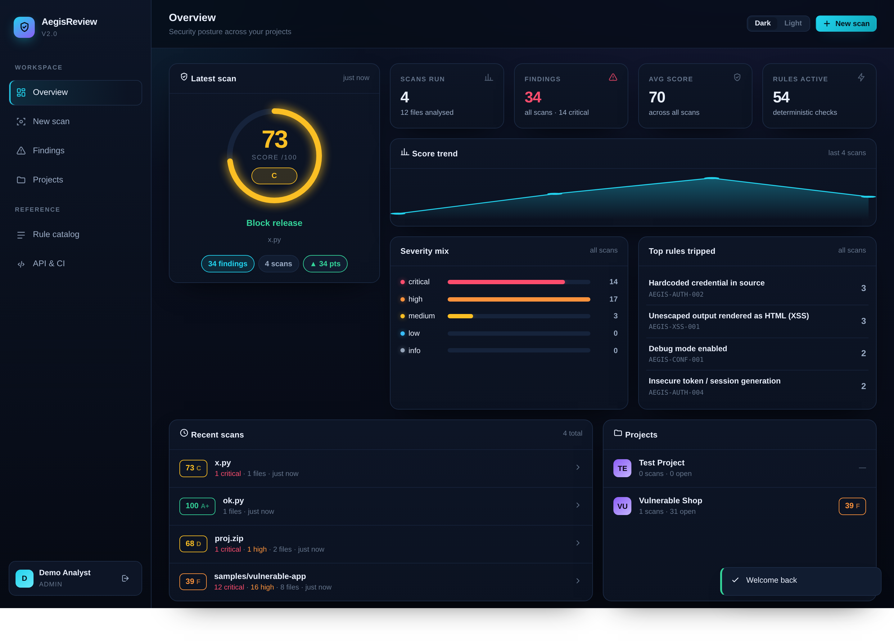
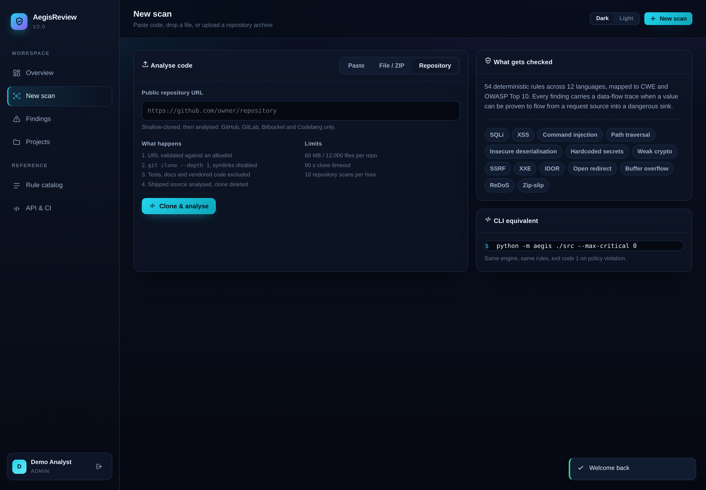
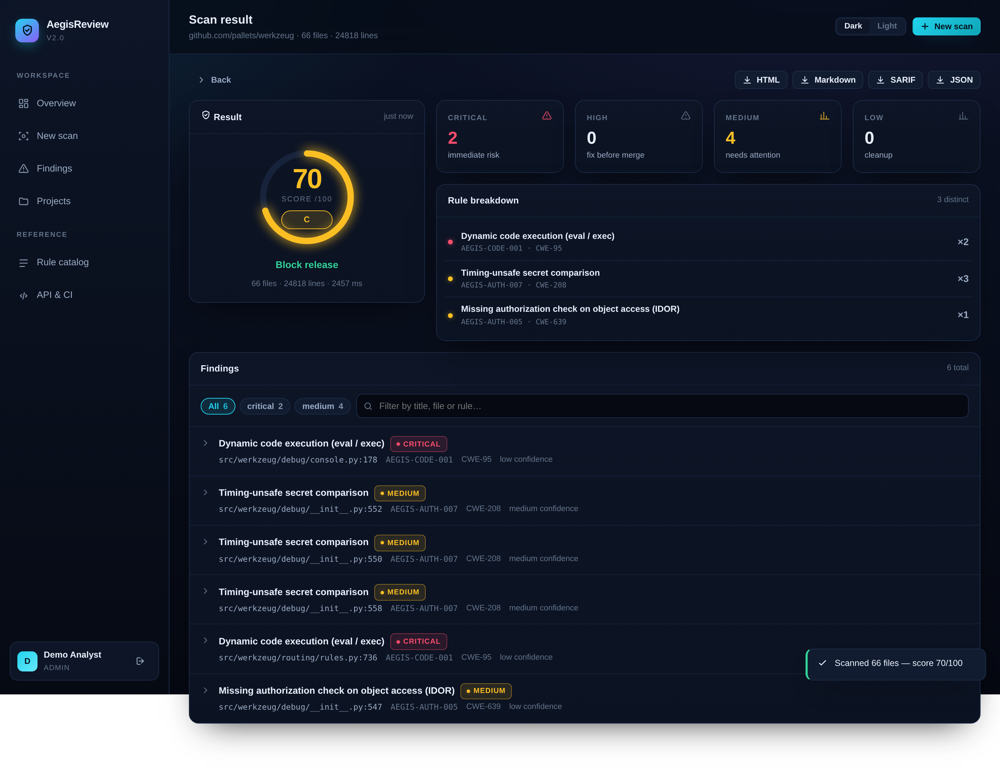

# AegisReview

**Deterministic static security analysis for source code** — 53 rules, real
data-flow traces, a 0–100 risk score, SARIF export and a CI gate that can
block a merge.

Runs offline. No API key, no LLM, no network calls, no vendor lock-in. Same
input always produces the same report, which is what makes it safe to wire into
a pipeline.

```bash
git clone https://github.com/Panelv4/aegisreview-ai-v2 && cd aegisreview-ai-v2
pip install -r requirements.txt
python run.py            # dashboard on http://localhost:8000
```

Sign in with the seeded demo account — `demo@aegis.dev` / `aegis-demo-2024`.

---

## What this actually is

This repository began life as a Flask/HTML project that *described* AI-powered
vulnerability detection but contained **no analysis code at all** — the browser
posted to `localhost:5000` routes that did not exist, and the backend was an
unrelated FastAPI service with no `Scan` or `Finding` model.

AegisReview 2.0 replaces the shell with a working product:

| | Before | Now |
|---|---|---|
| Analysis engine | none | 53 rules, 22 languages, 43 CWEs, taint tracing |
| Frontend ↔ backend | called non-existent Flask routes | single FastAPI app serving API + UI |
| Data model | `User`, empty `Project` | `Scan` + `Finding` with triage state and history |
| Scoring | none | weighted 0–100 score, grade, release verdict |
| Reports | none | HTML, Markdown, JSON, SARIF 2.1.0 |
| CI enforcement | none | policy gate → exit code 1 / HTTP 409 |
| Precision work | n/a | false-positive guards, suppression, self-scan at 100/100 |



| Repository scan | Results |
|---|---|
|  |  |

---

## Quick start

### CLI

```bash
python -m aegis ./src                                  # human-readable report
python -m aegis ./src --max-critical 0 --max-high 3    # fails the build on violation
python -m aegis ./src -f sarif -o aegis.sarif          # GitHub code scanning
python -m aegis ./src -f markdown -o review.md         # PR comment

python -m aegis --repo https://github.com/pallets/werkzeug   # clone and scan a repo
```

Exit codes: `0` clean or within budget, `1` policy violation, `2` bad path.

### Dashboard

```bash
python run.py
```

Paste code, drop a file, upload a `.zip`, or point it at a public repository.
Every finding expands into the offending line, a source→sink trace when one
exists, the reason it matters, and a vulnerable/fixed diff.

### Repository scanning

Cloning a URL a user supplies is the most dangerous feature in a scanner, so it
is fenced rather than trusted (`aegis/repofetch.py`):

| Risk | Mitigation |
|---|---|
| `ext::` transport = command execution | only `https://` URLs, host allowlist |
| SSRF against internal hosts | `169.254.169.254`, `localhost`, unknown hosts all rejected |
| Symlink escape (`link -> /etc/passwd`) | `core.symlinks=false` writes the target as inert text |
| Archive/zip bombs, huge repos | 60 MB and 12,000-file caps after clone |
| Hanging on a credential prompt | `GIT_TERMINAL_PROMPT=0`, 90 s timeout |
| Resource abuse | 10 repository scans per hour per user |

Scans run on shipped code: test fixtures, `docs/`, `examples/` and vendored
third-party code are excluded, because a vulnerability in a demo file is not
one you can fix.

### Docker

```bash
docker compose up --build       # app + PostgreSQL
```

---

## The engine

```
aegis/engine/
├── rules.py      53 declarative rules (id, CWE, OWASP, patterns, taint pairs, fix)
├── analyzer.py   mask → match → trace → entropy → score
├── models.py     Finding / FileReport / ScanResult, scoring
├── policy.py     CI gate + baselines
└── exporters.py  SARIF 2.1.0, Markdown, self-contained HTML
```

**1. Mask, don't skip.** Comments and string literals are blanked with
width-preserving spaces before matching, so a rule can never fire on prose
(`# never call eval()`) or on a docstring that mentions a dangerous call. Multi-line
constructs — Python triple quotes, JS template literals, block comments — are
tracked across lines.

**2. Declarative rules.** Adding a check is a data edit, not a code change:

```python
Rule(
    id="AEGIS-CMDI-001",
    title="OS command injection",
    severity="critical", confidence="high",
    cwe="CWE-78", owasp="A03:2021 - Injection",
    languages=("python",),
    why="...", fix_hint="...", vuln_example="...", fix_example="...",
    patterns=(Pattern(regex=r"\bos\.(?:system|popen)\s*\(", message="..."),),
    taint=(TaintPair(source=_SRC_PY, sink=..., label="HTTP input -> command"),),
)
```

**3. Taint tracing.** When a rule declares sources and sinks, the analyzer looks
backwards for the assignment that introduced untrusted data **and verifies the
variable actually reaches the sink**. That check is deliberately conservative:
without it the engine "proves" flows across unrelated scopes and inflates
confidence. A rule whose trace cannot be proven reports at its
`confidence_without_trace` level instead.

**4. Entropy sweep.** Secrets with no recognisable prefix are caught by Shannon
entropy over values assigned to secret-like names — and the literal is redacted
in the report so the tool never becomes the leak.

**5. Sanitizer awareness.** A sink is not a vulnerability. `eval(compile(f.read(),
path, "exec"))` runs a *local* config file — legitimate. When a sink's arguments
trace to a sanitising call (`compile`, `literal_eval`, `shlex.quote`,
`secure_filename`, `mark_safe` on already-escaped value), the finding is kept but
reported at reduced confidence instead of being dropped.

**6. Scoring.**

```
risk_points = Σ severity_weight × confidence_factor
              (critical 10, high 6, medium 3, low 1)
              (high ×1.0, medium ×0.7, low ×0.3)
score       = clamp(100 - 26·log10(1 + risk_points), 0, 100)
```

Confidence weighting matters: a hint and a proven RCE must not move the score
identically. Logarithmic damping stops one noisy file from outranking a single
RCE, and `100` is reserved for *zero findings*.

### Measured against real code

Scanning popular open-source projects is the only honest precision test. After
tuning against these, confirmed findings (medium+ confidence) are:

| Repository | Files | Score | Medium+ findings |
|---|---|---|---|
| psf/requests | 35 | 100 | 0 |
| pallets/itsdangerous | 18 | 100 | 0 |
| pallets/click | 29 | 100 | 0 |
| pallets/flask | 35 | 78 | 0 (2 low-confidence `exec(compile(...))`) |
| httpie/cli | 106 | 71 | 2 (a real `verify=False`) |
| pallets/werkzeug | 66 | 70 | 3 (real timing-unsafe debugger pin comparison) |
| django/django | 693 | 48 | 10 (`pickle` cache backends — by design) |

Every false positive found this way became a rule guard and a regression test:
`mark_safe()` on an already-escaped value, md5 outside a password context,
`string.Template` mistaken for SSTI, a variable named `token` that was a lexer
token, and format-string constants flagged as secrets.

### Coverage

Injection (SQL, command, code, SSTI, LDAP, XPath, PHP include, SpEL) ·
XSS (DOM, template) · path traversal · insecure deserialisation · hardcoded and
high-entropy secrets · weak password hashing · JWT verification · weak PRNG ·
broken ciphers · TLS verification · SSRF · XXE · zip-slip · unvalidated upload ·
mass assignment · IDOR · open redirect · C/C++ memory safety · Java deserialisation ·
prototype pollution · ReDoS · missing security headers · permissive CORS · and more.

**53 rules · 22 languages · 43 distinct CWEs · 15 critical / 22 high / 14 medium / 2 low**

Languages: Python, JavaScript, TypeScript, Java, C, C++, C#, PHP, Ruby, Go,
Kotlin, Swift, Rust, Shell, YAML/JSON/TOML/INI/Env, HTML, Vue, Terraform.

### Suppression and baselines

```python
os.system(cmd)  # aegis:ignore AEGIS-CMDI-001
eval(x)         # aegis:ignore            (whole line)
# aegis:ignore-file                       (whole file)
```

Fingerprints hash `rule + path + normalised code`, so an accepted finding keeps
its identity when lines move and a baseline survives refactors.

---

## API

Interactive docs at `/docs`.

```
POST   /api/scans/snippet            scan inline code (auth optional)
POST   /api/scans/upload             file or .zip archive
GET    /api/scans/{id}               full report
POST   /api/scans/repo               clone + scan a public repository
GET    /api/scans/{id}/export?fmt=   sarif | json | markdown | html
PATCH  /api/findings/{id}            triage: fixed / ignored / false-positive
POST   /api/ci/gate                  policy gate (409 on failure)
GET    /api/stats                    posture metrics
GET    /api/rules                    rule catalog (public)
POST   /api/auth/login               JWT login
```

```bash
curl -s localhost:8000/api/scans/snippet \
  -H 'Content-Type: application/json' \
  -d '{"code":"os.system(input())","filename":"x.py"}' | jq '.score, .findings[].rule_id'
```

---

## CI integration

```yaml
- name: Aegis security gate
  run: |
    pip install -r requirements.txt
    python -m aegis ./src --max-critical 0 --max-high 0 --min-score 80

- name: Upload SARIF
  if: always()
  uses: github/codeql-action/upload-sarif@v3
  with:
    sarif_file: aegis.sarif
```

Findings appear inline on the PR diff with severity, CWE, remediation and
fingerprints for deduplication across runs.

---

## Testing

```bash
python -m pytest tests/ -q      # 129 tests
```

The suite tests detection *and* precision: every true positive has a
corresponding guard test proving the safe pattern is not flagged, plus
regression tests for each false positive found while dogfooding the engine
against its own source and against real repositories. One test asserts the
engine's own source scans clean — if precision regresses, that test fails.
Dangerous repository URLs (`ext::`, `file://`, cloud metadata, embedded
credentials) are tested directly against the validator.

---

## Project layout

```
aegis/
├── engine/        analysis core (no web dependencies — usable standalone)
├── repofetch.py   hardened git clone (allowlist, symlink + size guards)
├── api/           FastAPI app, schemas, routes
├── static/        dashboard (vanilla JS, no build step, no CDN)
├── db.py          SQLAlchemy models
├── security.py    bcrypt + JWT
└── __main__.py    CLI
samples/           deliberately vulnerable app used by tests and demo
tests/             111 engine + API tests
```

The engine has zero web dependencies, so it can be embedded in a worker, a
pre-commit hook or another service without dragging FastAPI along.

---

## Configuration

Copy `.env.example` to `.env`. Nothing is required for local use.

| Variable | Default | Notes |
|---|---|---|
| `DATABASE_URL` | `sqlite:///./aegis.db` | set a PostgreSQL URL in production |
| `SECRET_KEY` | ephemeral | **required** in production, else sessions drop on restart |
| `MAX_UPLOAD_MB` | `5` | per-file limit |
| `MAX_REPO_MB` | `25` | per-archive limit |
| `SEED_DEMO` | `true` | creates the demo account and a sample scan |
| `AEGIS_GIT_TOKEN` | unset | optional server-side token for private repo scans |
| `ALLOW_REGISTRATION` | `true` | set `false` once your team is onboarded |

---

## Design decisions

**Why no LLM in the detection path?** Detection needs to be reproducible and
auditable — "the model said so" is not a review comment a developer can act on,
and a nondeterministic gate gets switched off within a week. Every finding here
is traceable to a named rule, a regex, and usually a data-flow trace.

**Why static regex+heuristics instead of full AST analysis?** Parsing every
language properly means shipping a parser per language. Declarative patterns
plus masking plus taint tracing cover the high-signal classes with no runtime
dependencies, and a rule takes minutes to add. The trade-off is honest: this is
a fast triage and gate tool, not a replacement for dedicated AST taint engines
on high-assurance code.

**Why is the self-scan test in the suite?** A scanner that cannot pass its own
gate is not trustworthy. Keeping that assertion green forces every new rule to
be evaluated for precision before it lands.

---

## Limitations

- Pattern-based detection; it does not follow values across function
  boundaries or through object fields.
- The taint window is a 25-line lookback within one file.
- No dataflow through ORMs that build queries indirectly.
- Languages are detected by extension/shebang; an uncommon extension can fall
  back to `unknown` and be skipped.

Genuine complements: dependency/CVE scanning, container image scanning, secret
scanning with history (`git log -p`), and runtime DAST.

---

## License

MIT — see `LICENSE`.
